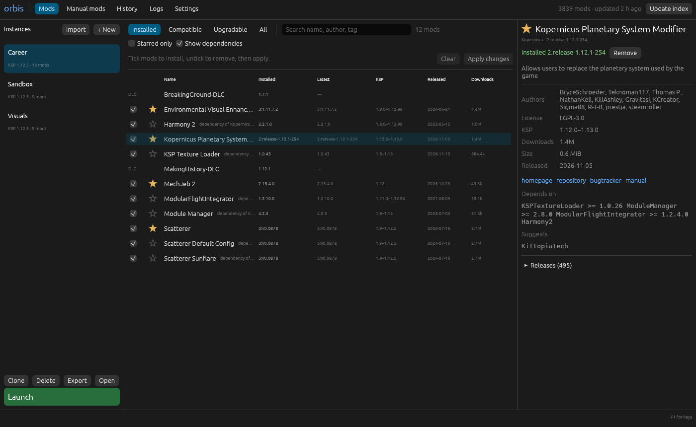

# orbis

A Kerbal Space Program mod manager with Prism-style instances, built on CKAN metadata.



## Overview

orbis is a Linux rewrite of [CKAN](https://github.com/KSP-CKAN/CKAN) for KSP 1, built on the metadata the CKAN project maintains and inspired by [Prism Launcher](https://prismlauncher.org/). Every instance has its own mods, saves and settings, like Prism Launcher instances for Minecraft, and links the stock game from your KSP install (Steam, GOG or any other) without ever changing it, so launching KSP from Steam stays vanilla. Mods come from the CKAN index with full dependency resolution, and mods CKAN doesn't carry (Patreon builds, betas, personal patches) live in a manual mod library that any instance can use. It ships as a single binary with a GUI and a scriptable CLI, keeps itself up to date from GitHub releases, and runs the Windows build of KSP through Proton or Wine, or the native Linux build directly.

## Features

* **Instances**: as many as you like, each holding only its mods, saves and settings (about 15 MB) and linking the stock game from your Steam install, which is never written to.
* **CKAN mods**: browse, search, install, upgrade and remove the whole CKAN catalogue, with dependencies, conflicts, recommendations and provider choices handled the way CKAN does.
* **Categories**: the mod list is grouped by category and colour coded, from CKAN's tags or your own choices (custom categories too), with each group foldable and the DLC listed above it.
* **Dependencies out of the way**: the Installed list shows the mods you chose; dependencies stay hidden behind a checkbox and say which mods need them.
* **Starred mods**: star the mods you always use, then show only starred mods in any list and queue them all at once in a new instance.
* **Shared craft**: every craft you save in any instance lands in one library and is copied into every instance that has the parts for it, with revisions, a trash and an explanation of what's missing where it doesn't fit.
* **Custom flags**: add your own flag images once, on the Flags tab or with `orbis flag add`, and pick them in every instance.
* **Modpacks**: export an instance's mods (optionally with craft, saves and manual mod files) and import them as a new instance; CKAN's `.ckan` modpacks work both ways.
* **Save backups**: saves are snapshotted before every mod change and launch (only when their contents changed), with one-click restore of a single save or all of them.
* **History and undo**: every change is recorded; undo the last one or put the mod list back to any earlier point, exact versions included.
* **Log viewer**: read KSP.log, Player.log and the launch log in the app, with exceptions grouped and traced to the mod whose code threw them.
* **Hand-added mods**: folders dropped into GameData by hand are spotted and can be adopted as tracked manual mods.
* **Sorting and dates**: sort by name, installed, release date or downloads to find recently updated mods.
* **Stays current**: the CKAN index refreshes itself when it's a day old, and instances show how many upgrades are waiting.
* **Remembers where you were**: the selected instance, filters and unapplied changes survive a restart.
* **Migrate from CKAN**: point orbis at a KSP folder CKAN manages and get an instance with the same mods, tracked at the same versions, plus its saves and settings.
* **Launch through Steam (optional)**: start an instance through Steam for the overlay and playtime tracking, while Steam's own Play button stays vanilla.
* **Manual mods**: add a `.zip` or folder once, then install it into any instance. A manual mod can replace CKAN mods (for example, a Patreon Volumetric Clouds build standing in for EVE Redux and Scatterer), so mods that depend on them keep working.
* **Any KSP install**: Steam, GOG, Heroic or a folder from the KSP store; the Windows build runs through Proton (the one Steam maps to KSP, inside the Steam Linux Runtime when it asks for it) or Wine, and the native Linux build runs directly.
* **Updates itself**: orbis checks GitHub for a new release when it starts (or when you ask), and one click downloads it, checks its SHA-256, and replaces the binary.
* **Bug reports**: one button (or `orbis report`) copies your setup, mod list and grouped log errors, with your home folder and user name taken out, ready to paste into an issue.
* **Per-instance settings**: compatible KSP versions, testing releases, launch arguments, environment variables, and a shared or separate Wine prefix.
* **Reliable downloads**: parallel downloads that drop stalled connections and resume where they left off, falling back to CKAN's archive.org mirror for freely licensed mods.
* **One copy of each mod**: every mod version is unpacked once into a shared store; on btrfs and XFS instances get reflinked copies that share disk space but keep their own files.
* **Mouse or keyboard**: everything works by point and click, with standard keyboard shortcuts and vim-style keys alongside (press `F1` to list them).
* **Safe file handling**: every installed file is tracked per mod, and applying changes is all or nothing: every install is checked for conflicts before anything is removed, and a failure or cancel part-way puts the instance back exactly as it was. Nothing changes while an instance's game is running.
* **GUI and CLI**: an egui interface, plus a CLI covering every operation.
* **Headless rendering**: the GUI renders offscreen to PNG with a text state dump, so it can be checked without a display.
* **Pure Rust**: a single binary with no C dependencies; downloads go through the system `curl`.

## Installation

### Requirements

* Linux on x86_64
* `curl` and `bsdtar` at runtime (on Debian and Ubuntu, `bsdtar` is in `libarchive-tools`)
* A Vulkan driver (any GPU driver, or lavapipe for software rendering)
* KSP 1 from Steam, GOG or the KSP store: the Windows build with Proton (Proton-GE or Valve Proton) or Wine, or the native Linux build
* To build from source: Rust 1.100 or newer and Make

### Download

Download `orbis-x86_64-linux.tar.gz` from the [latest release](https://github.com/grunclepug/orbis/releases/latest), unpack it, and put `orbis` somewhere you can write to and that's on your `PATH`, such as `~/.local/bin`:

```sh
tar xzf orbis-x86_64-linux.tar.gz
install -Dm755 orbis-x86_64-linux/orbis ~/.local/bin/orbis
```

orbis can then update itself (Settings > About, the button that appears in the top bar, or `orbis self-update`). It can't replace a binary installed by a package manager or with `sudo`; update those the way you installed them.

### Build

```sh
git clone https://github.com/grunclepug/orbis
cd orbis
make build
sudo make install    # optional, installs to /usr/local/bin
```

## Usage

Run `orbis` with no arguments to open the GUI:

1. Press **Update index** to download the CKAN catalogue.
2. Press **+ New** to create an instance from your KSP install (Steam's, or a GOG or other folder).
3. Tick mods in the **Compatible** list, press **Apply changes**, and confirm.
4. Press **Launch**.

The same steps from the CLI:

```sh
orbis update
orbis instance create "Stock Career"      # linked to the Steam install (--from <dir> for another)
orbis search scatterer -i "Stock Career"
orbis install -i "Stock Career" Scatterer EnvironmentalVisualEnhancements
orbis launch "Stock Career"
```

When only one instance exists, `-i` can be left out.

### CLI commands

| Command | Action |
|---------|--------|
| `orbis gui` | Open the GUI (the default with no command) |
| `orbis update` | Download the latest CKAN index |
| `orbis search <query> [-i <instance>]` | Search mods, optionally only those compatible with an instance |
| `orbis show <identifier>` | Show a mod's details, relationships and releases |
| `orbis list [-i <instance>]` | List installed mods and detected DLC |
| `orbis install [-i <instance>] <mod>[=<version>]...` | Install mods and their dependencies |
| `orbis remove [-i <instance>] <mod>...` | Remove mods and anything that depends on them |
| `orbis upgrade [-i <instance>] [<mod>...]` | Upgrade the named mods, or every upgradable one |
| `orbis instance list\|create\|clone\|sync\|rename\|delete\|info\|compat` | Manage instances |
| `orbis instance import-ckan <dir> [--copy]` | Create an instance from a KSP install CKAN manages |
| `orbis instance launcher [<instance>] [--via direct\|steam] [--runner auto\|proton\|wine\|native]` | Start the instance directly or through Steam, and pick what runs it |
| `orbis manual list\|add\|show\|install\|delete` | Manage the manual mod library |
| `orbis flag list\|add <png> [--name]\|remove <name>` | Manage the custom flag library |
| `orbis craft list [-i <instance>] [--trash]` | List the craft library and whether each craft fits an instance |
| `orbis craft sync` | Collect new and changed craft and update every instance that isn't running |
| `orbis craft add <file>\|import <dir>` | Add a craft file, or every craft under a folder |
| `orbis craft delete\|restore <craft>`, `orbis craft empty-trash` | Delete a craft everywhere, bring it back, or empty the trash |
| `orbis craft history <craft>`, `orbis craft fork <craft> <n> --name <name>` | Show a craft's revisions, or save one as a new craft |
| `orbis craft pending [--delete <n>\|--put-back <n>]` | List or settle craft that went missing and wait for a decision |
| `orbis launch [<instance>] [--dry-run]` | Start an instance, or print the command |
| `orbis steam` | Show the detected Steam, KSP and Proton paths, and KSP installs outside Steam |
| `orbis report [-i <instance>]` | Print a bug report to paste into a GitHub issue |
| `orbis self-update [--check]` | Update orbis to the latest release, or only say whether one exists |
| `orbis history list\|undo\|restore <id> [--before]` | Show changes, undo the last one, or restore an earlier mod list |
| `orbis backup list\|create\|restore <id> [--save <name>]` | Manage save backups |
| `orbis logs [--log ksp\|player\|launch]` | Summarise a log: exceptions grouped and blamed on mods |
| `orbis manual unmanaged\|adopt <folder>` | Find hand-added GameData folders and track them as manual mods |
| `orbis cache [--clean\|--share]` | Show the mod store and download cache, remove what no instance uses, or make older installs share disk space |
| `orbis star\|unstar <mod>...` | Star or unstar mods (shared by all instances) |
| `orbis starred` | List starred mods |
| `orbis pack export [-i <instance>] <file>` | Export a modpack (`--craft`, `--saves <names\|all>`, `--manual-files`, `--ckan`) |
| `orbis pack import <file>` | Create an instance from an `.orbispack` or CKAN `.ckan` modpack (`--name`, `--from <dir>`, `--latest`) |

`install`, `remove` and `upgrade` show the plan and ask before applying it. Pass `-y` to skip the question, `--dry-run` to only show the plan, and `--choose '<relationship>=<identifier>'` to answer a provider choice.

### Configuration

Settings live in `~/.config/orbis/config.toml` and can also be edited on the GUI's Settings tab.

| Variable | Flag | Default | Description |
|----------|------|---------|-------------|
| `steam_root` | | detected | Steam's root directory |
| `proton` | | the Proton Steam maps to KSP | Directory holding the `proton` script |
| `wine` | | `wine` on `PATH` | The Wine binary for instances that run through Wine |
| `use_steam_runtime` | | `true` | Run Proton inside the Steam Linux Runtime when Proton asks for it |
| `repositories` | | CKAN-meta `master.tar.gz` | CKAN metadata archives, each a `{ name, url }` table |
| `download_workers` | | `4` | Parallel mod downloads (1 to 16) |
| `backups_keep` | | `10` | Save backups kept per instance; `0` turns automatic backups off |
| `auto_update_hours` | | `24` | Refresh the CKAN index on GUI start when it is older than this; `0` turns it off |
| `check_updates` | | `true` | Look for a new orbis release when the GUI starts |
| | `--root <dir>` | XDG directories | Keep config, data and cache under one directory |
| `RUST_LOG` | | `warn` | Log level, written to stderr |

Per-instance settings (compatible versions, testing releases, what runs the game, launch arguments, environment, prefix) live in each instance's `instance.toml` and on the Settings tab.

orbis records the layout of its data in `~/.local/share/orbis/format.toml`. An older orbis refuses data that a newer one has moved to a new layout, instead of misreading it.

## Instances

An instance is a directory under `~/.local/share/orbis/instances/<id>/`:

```
instance.toml   name, linked install, game version, compatible versions, launch settings
registry.json   installed mods and the files each one owns
crafts.json     where library craft sit in this instance's saves
parts.json      the parts this instance provides, from its last craft sync
running.toml    the process running the game, while it runs
game/           the KSP directory the game runs from
prefix/         a separate Wine prefix, when the instance uses one
```

By default an instance links to a game install (the Steam one, or `--from <dir>`). Its `game/` directory holds real copies only of what belongs to the instance:

* `GameData`, with the stock `Squad` and `SquadExpansion` folders linked in and your mods installed beside them
* `saves` (starting with the stock scenarios and training; add `--with-saves` to copy your existing saves)
* `Ships`, `Missions`, `UserLoadingScreens`, `settings.cfg` and `Physics.cfg`

Everything else (`KSP_x64.exe`, `KSP_x64_Data`, the DLLs and so on) is a symlink into the install. The native Linux build is the exception: Unity finds the game through the executable's real path, so `KSP.x86_64` and `UnityPlayer.so` are copied (reflinked on btrfs and XFS, refreshed when the install updates), and `KSP_Data` is a real folder of links. orbis never writes to the install: the installer refuses any file that would land behind a link, and deleting an instance removes only the links. Launching KSP from Steam therefore stays vanilla, and Steam Cloud never sees an instance's saves.

Before every launch, orbis re-checks the links (`orbis instance sync` does the same by hand): it adds links for files a Steam update introduced, drops links to removed ones, and records the install's current game version. If you'd rather an instance keep its game version when Steam updates, create it with `--copy` (or tick **Full copy** in the GUI) for a complete, independent copy. On btrfs or XFS that copy is reflinked, so it is instant and takes no extra space.

Instances share Steam's KSP Wine prefix by default. That's safe because KSP keeps its saves and settings in the game directory. Switch an instance to a separate prefix in its settings if you want full isolation; Proton builds it on first launch.

## Manual mods

The manual library lives in `~/.local/share/orbis/manual/`. Add a mod in the GUI (**Manual mods > + Add mod**, or drop a file on the window) or with the CLI:

```sh
orbis manual add ~/Downloads/VolumetricClouds.zip --name "Volumetric Clouds" --version 5.0 \
    --provides EnvironmentalVisualEnhancements,Scatterer
orbis manual install volumetric-clouds -i "Stock Career"
```

orbis works out where the files go: if the archive has a `GameData` folder anywhere, its contents are installed; otherwise each top-level folder goes into `GameData`. Use `--find <folder>` to install a single folder instead. `.zip`, `.7z` and `.rar` archives and plain folders all work; `.7z` and `.rar` are unpacked once into the library with `bsdtar`.

`--provides` lists the CKAN identifiers the mod replaces. Installing it removes the CKAN copies, and CKAN mods that depend on those identifiers are satisfied by the manual mod. `--depends` and `--conflicts` take CKAN identifiers too.

### Keys

Everything works with the mouse; keys are a faster path alongside it, and none of them act while you type in a text box. Right-click an instance for Launch, Clone, Rename, Export, Open folder and Delete; double-click it to launch. Press `F1` (or `?`) in the app to see all keys.

These always work:

| Key | Action |
|-----|--------|
| `Up` / `Down` | Previous / next mod |
| `Page Up` / `Page Down` | A page up / down |
| `Home` / `End` | First / last mod |
| `Left` / `Right` | Previous / next filter |
| `Space` | Tick the mod: queue an install, or a removal |
| `Delete` | Queue removal of the selected mod |
| `Enter` | Apply queued changes; in dialogs, the main button |
| `Esc` | Cancel a dialog |
| `Ctrl+F` | Search |
| `Ctrl+Up` / `Ctrl+Down` | Previous / next instance |
| `Ctrl+Tab` / `Ctrl+Shift+Tab` | Next / previous tab |
| `Ctrl+1` to `Ctrl+7` | Mods, Manual mods, Flags, Crafts, History, Logs, Settings |
| `Ctrl+Z` | Undo the last mod change (asks first) |
| `F2` | Rename the instance |
| `F5` | Re-read instances from disk |
| `F1` or `?` | Show the keys |

Vim-style keys work too, unless turned off under **Settings > Interface**:

| Key | Action |
|-----|--------|
| `j` / `k` | Next / previous mod |
| `gg` / `G` | First / last mod |
| `Ctrl+D` / `Ctrl+U` | Half a page down / up |
| `x` | Tick the mod |
| `u` | Queue an upgrade |
| `s` | Star or unstar |
| `/` | Search |
| `h` / `l` | Previous / next filter |
| `J` / `K` | Next / previous instance |
| `gt` / `gT` | Next / previous tab |
| `za` | Fold or open the selected mod's category |
| `zR` / `zM` | Open / fold every category |

## Categories

The mod list is grouped by category, each with its own colour, shown as a dot on its heading and a bar beside every row. Click a heading to fold the group, or use **Expand all** / **Collapse all**; a search or **Starred only** shows every match whatever is folded, and counts and bulk actions always include folded mods. Categories come from the tags CKAN gives each mod (`parts`, `graphics`, `comms` and so on); a mod tagged both as a library and with what it does (Parallax: `graphics` and `library`) goes with what it does. To put a mod somewhere else, pick a category under **Details** in its panel, or **New category...** for one of your own, such as Rovers or Satellites. Your choices live in `~/.local/share/orbis/categories.toml` and apply to every instance. **Group by category** above the list turns grouping off.

## Flags

The flag library lives in `~/.local/share/orbis/flags/`. Add a PNG on the **Flags** tab (**+ Add flag**, or drop it on the window) or with the CLI:

```sh
orbis flag add ~/Pictures/my-agency.png --name "My Agency"
```

Every instance has a `GameData/OrbisFlags/Flags` link to the library, so a flag you add shows up in every instance's flag picker under `OrbisFlags/Flags/<name>`, with nothing to install. KSP's own flags are 256 by 160 pixels; other sizes are stretched to fit. Deleting a flag makes saves and craft that used it show the default flag.

## Crafts

The craft library lives in `~/.local/share/orbis/crafts/`. Every craft saved in any instance is collected into it and copied into every save of every instance that has all of its parts, so a craft built in one instance shows up in the others. A craft that needs a part an instance lacks stays out of that instance, and the **Crafts** tab says which mod it needs and which instance has it.

orbis syncs before each launch, when a game it started (directly or through Steam) exits, when the GUI opens or you press `F5`, after mod changes, and with **Sync now** or `orbis craft sync`. It never touches an instance whose game is running.

* **Saving over a craft** makes a new revision. If the new revision needs a part another instance lacks, that instance's copy is removed; the old revision stays in the craft's **History**, where **Save as new** keeps it as a craft of its own (for a stock version, say).
* **Saving under a new name** (Orbiter II from Orbiter I) makes a new craft. orbis doesn't guess that the two are related.
* **Deleting a craft in KSP** deletes it from every instance and puts it in the trash, where **Restore** brings it back. When several craft vanish from one save at once, orbis asks instead of deleting them. A deleted save or a restored backup never counts as deleting its craft.
* **Changing a craft in two instances** before a sync keeps both: the second becomes `<name> (<save>)`. The same goes for two different craft with the same name.
* **Moving a craft** into a folder of the craft browser keeps it; orbis follows it.

Autosaves (`Auto-Saved Ship`) and backup folders mods make (`*_Backup`) are left out. Whether an instance has a part comes from its mod files, checked against ModuleManager's cache once the game has been launched; parts a patch creates count once the game has run. Add craft from elsewhere with **+ Add craft** (a `.craft` file, or a folder such as an old install's `saves`, whose thumbnails come along) or by dropping a `.craft` file on the window.

## Mod store

Downloaded archives are unpacked once into `~/.local/share/orbis/store/`, one folder per mod version, and installs copy from there. On btrfs and XFS the copy is a reflink: ten instances with the same mod use the disk space of one, yet each instance has its own files, so a mod that writes settings or caches into its folder while the game runs never affects another instance. Instances can still use different versions of a mod (a pinned modpack, say); each version is stored once. On other filesystems the copies are ordinary copies.

`orbis cache` (or **Settings > Storage**) shows the store and download cache; `orbis cache --clean` removes what no instance uses. Mods installed before the store existed are separate copies; `orbis cache --share` (or **Share space with older installs**) compares their files with the store and replaces every identical one with a shared copy. Files a mod has changed are left alone, and it only runs on btrfs and XFS, where it saves space.

Any running task that downloads or installs (updating the index, applying changes, importing a pack, restoring history, sharing space) has a **Cancel** button. Cancelling while changes are being applied puts the instance back as it was; partial downloads resume next time.

## Safety nets

**Save backups.** Before applying mod changes and before each launch, orbis copies the instance's saves into `backups/` inside the instance, but only when they changed since the last backup. The newest `backups_keep` are kept. On btrfs and XFS the copies are reflinks and take no space until a save changes. Restoring (one save, or all of them) backs up the current saves first, so a restore can itself be undone. Find them on the **History** tab or with `orbis backup`.

**History.** Every applied change is recorded in `history.json` with the mod list before and after it. **Undo** reverses the newest change; **Restore this point** returns to how things were right after any earlier one. orbis reinstalls the exact versions (falling back to the newest compatible release, with a warning, if one has left CKAN) and keeps dependency flags as they were.

**Logs.** The **Logs** tab reads `KSP.log`, Unity's `Player.log` (in the Wine prefix, or in `~/.config/unity3d` for the native build, so instances that share one see whichever ran last) and Proton's launch log. Repeated exceptions are grouped, and each is traced to the mod whose code appears in its stack trace, by DLL name or, when the namespace differs (MechJeb's `MuMech`), by the names stored inside the mod DLLs.

**Hand-added mods.** Folders in GameData that no installed mod owns are listed on the **Manual mods** tab. **Adopt** turns one into a manual mod: a copy goes into the library, and the files already in the instance are tracked as installed, so orbis can remove, back up and export it like any other mod.

## Modpacks

An `.orbispack` is a zip with a `pack.toml` (the mod list at exact versions, which mods are dependencies, compatible game versions and launch settings) plus whatever you chose to include:

```sh
orbis pack export -i "Stock Career" career.orbispack --craft --saves "My Career"
orbis pack import career.orbispack --name "Career (friend)"
```

Importing creates a new linked instance, installs the pack's exact versions (or the newest compatible ones with `--latest`; a version that has left CKAN falls back to the newest with a warning), copies in the saves and craft, and keeps dependencies marked as dependencies. A pack with saves and craft makes a custom scenario: share it and the other side starts from the same point.

Manual mod files are left out unless you pass `--manual-files`, since mods like Patreon builds usually aren't yours to share. Without them, the pack still lists the manual mod; importing reuses your library copy when you have the same version, and warns otherwise.

`--ckan` writes CKAN's modpack format instead (mods only), and `.ckan` modpacks from CKAN import like any other pack. In the GUI, use **Export** under the instance list and **Import** beside **+ New**, or drop a pack file on the window.

## Migrating from CKAN

**Import** (beside **+ New**) accepts a KSP folder that CKAN manages, or use `orbis instance import-ckan <dir>`. orbis reads CKAN's `CKAN/registry.json` and creates an instance where every mod CKAN installed is tracked at the same version, with the same files and the same dependency flags, along with the install's saves, craft and compatible game versions. Folders in GameData that CKAN didn't track show up under **Manual mods** to adopt. The instance links the stock files from that folder (keep it), or with **Full copy** / `--copy` becomes fully independent. The CKAN install itself is left untouched.

## Launching

An instance's **Runs with** setting (`orbis instance launcher --runner`) picks what starts the game. **Automatic** runs the Windows build through Proton when one is found and through Wine otherwise, and runs the native Linux build when that's the build the install holds. Steam installs the native build when KSP's **Force the use of a specific Steam Play compatibility tool** is off; GOG and the KSP store offer both.

* **Native**: orbis runs `KSP.x86_64` from the instance's `game/` directory with `LC_ALL=C` (KSP misreads its config files under locales with a decimal comma; set `LC_ALL` in the instance's environment to override). Unity writes `Player.log` to `~/.config/unity3d/Squad/Kerbal Space Program/`.
* **Wine**: orbis runs `wine KSP_x64.exe` with `WINEPREFIX` set to the instance's own prefix, `prefix/pfx`.
* **Proton**: below. Proton also works without Steam (set `proton` in `config.toml`); the instance then gets its own prefix.

With Proton, orbis runs `KSP_x64.exe` from the instance's `game/` directory with the Proton build Steam has mapped to KSP, passing the same `STEAM_COMPAT_*` environment Steam does (plus `STEAM_COMPAT_MOUNTS`, so the runtime container can see the linked install). When that Proton requires the Steam Linux Runtime, orbis starts it through the runtime's entry point just as Steam does. KSP 1 has no DRM, so Steam doesn't need to start the game, though the Steam overlay and playtime tracking don't apply. The game's console output, whatever runs it, goes to `orbis-launch.log` in the instance directory. `orbis launch --dry-run` prints the exact command.

### Through Steam

For the Steam overlay and playtime tracking, tick **Launch: Through Steam** in an instance's settings (or `orbis instance launcher --via steam`). It needs a one-time setup: in Steam, open KSP's **Properties > Launch Options** and enter the line orbis shows (also printed by `orbis steam`), which looks like:

```
/usr/local/bin/orbis steam-run %command%
```

When you press **Launch**, orbis leaves a short-lived note naming the instance and asks Steam to start KSP. Steam runs its usual command (Proton for the Windows build, the Steam Runtime for the native one) through `orbis steam-run`, which consumes the note and points the command at the instance's game directory. Without a fresh note (pressing Play in Steam, or a note older than two minutes) the command runs unchanged, so KSP from the Steam library stays vanilla. If you move the orbis binary, update the launch options. The wrapper logs its last decision to `~/.cache/orbis/steam-run.log`.

## Credits

orbis stands on other people's work.

* **[CKAN](https://github.com/KSP-CKAN/CKAN)**: the Comprehensive Kerbal Archive Network made automatic KSP mod management possible. Every mod orbis can install comes from the metadata the CKAN team and its contributors maintain in [CKAN-meta](https://github.com/KSP-CKAN/CKAN-meta) through NetKAN, and orbis follows the CKAN client's behaviour closely: its version ordering, install stanzas, compatibility rules and DLC detection are ported from CKAN's source, used under its MIT license (see [NOTICE](NOTICE)). If you use orbis, you are using CKAN's work; consider supporting and contributing to the project.
* **[SpaceDock](https://spacedock.info/)**: hosts most of the mods orbis downloads, free for authors and players alike, and publishes the download counts orbis shows.
* **[Prism Launcher](https://prismlauncher.org/)**: the Minecraft launcher whose instances inspired orbis's design, from the instance list to cloning, modpacks and per-instance settings.
* **[The Internet Archive](https://archive.org/details/kspckanmods)**: keeps CKAN's mirror of freely licensed mods, which orbis falls back on when a host is slow or gone.
* **[Proton](https://github.com/ValveSoftware/Proton)** by Valve and **[Proton-GE](https://github.com/GloriousEggroll/proton-ge-custom)** by GloriousEggroll: what makes the Windows build of KSP run on Linux.
* **The mod authors**: thousands of people built the mods that make KSP what it is. orbis only fetches their work; follow the homepage and repository links on each mod to thank and support them.

orbis is an independent project and isn't affiliated with or endorsed by CKAN, SpaceDock, Prism Launcher, Valve, Squad or Private Division. Kerbal Space Program is a trademark of Take-Two Interactive.

## Development

```sh
make run ARGS="gui"   # run a debug build
make test             # unit and integration tests
make lint             # clippy with warnings as errors
make fmt              # rustfmt
make build            # release build
make gui-shot         # headless GUI render to target/gui.png and target/gui.txt (add ARGS="--keys 'jj<Down><C-f>'" to type keys)
make clean            # remove build output
```

## Contributing

Fork the repository and open a pull request.

## License

MIT. See [LICENSE](LICENSE). Portions are derived from CKAN, MIT licensed by the CKAN authors; see [NOTICE](NOTICE). The interface font, Noto Sans, is embedded under the SIL Open Font License; see [assets/fonts/OFL.txt](assets/fonts/OFL.txt).

## Author

Chad Humphries | [Website](https://grunclepug.com/) | [GitHub](https://github.com/GrunclePug) | [More projects](https://github.com/GrunclePug?tab=repositories)
